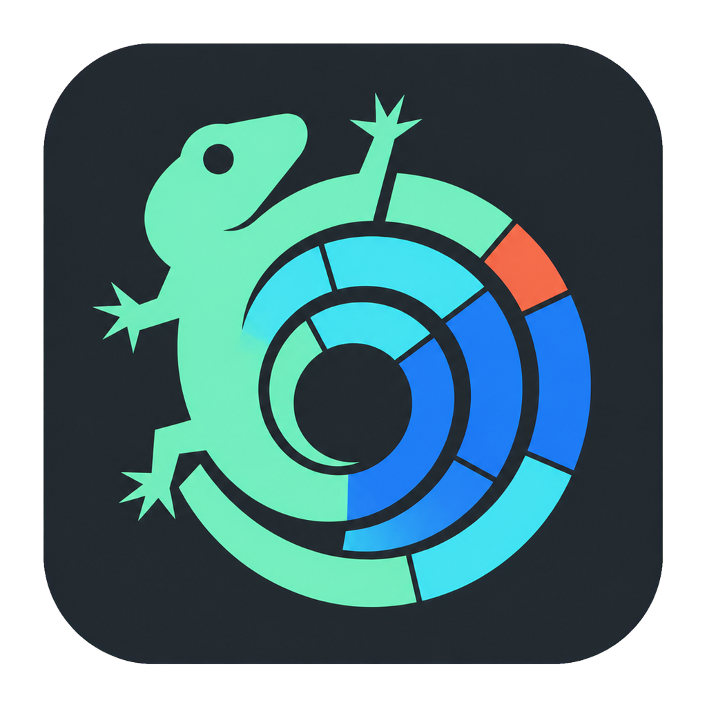
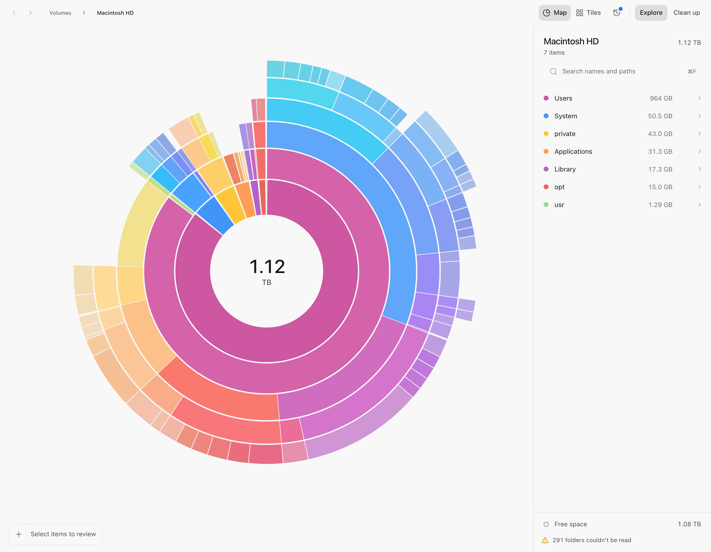
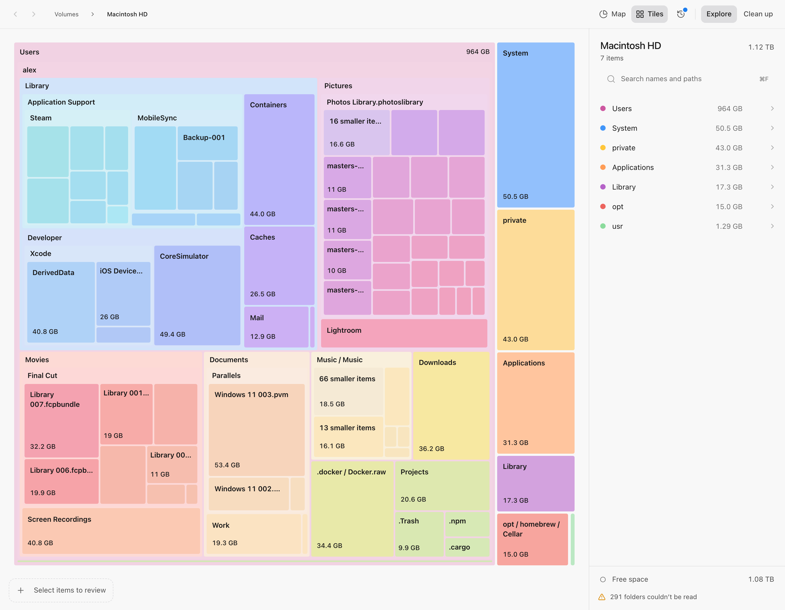
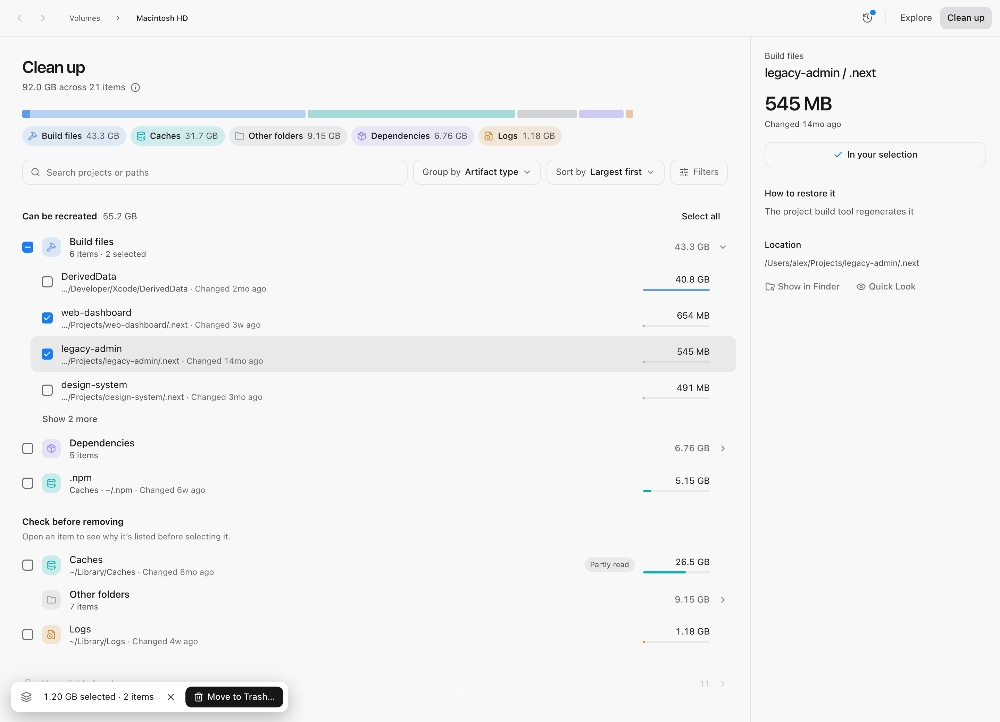

<p align="center">
  
</p>

<h1 align="center">DiskLizard</h1>
<p align="center">See what's using your disk. Review what can go.</p>

DiskLizard is a desktop disk explorer for macOS, Windows, and Linux. Scan a drive or folder, see where the space goes, and review what can be removed before anything moves to Trash.

> DiskLizard is under active development. Packaged releases are not available yet; the first public beta will be in English.

<picture>
  <source media="(prefers-color-scheme: dark)" srcset="docs/screenshots/storage-map-dark.png">
  
</picture>

- **See the whole disk at once.** An interactive ring map shows every folder by size; click to zoom in, click the center to zoom back out.
- **Switch to tiles** for a rectangle view of the same data, with the same colors and navigation.
- **Find developer clutter.** Dependencies, build output, and caches are grouped by type and project, with how to restore each one.
- **Nothing is deleted by surprise.** Drag or select items into a review, check the total, then move them to Trash or Recycle Bin.

| Browse as tiles | Review before cleaning up |
| --- | --- |
| <a href="docs/screenshots/storage-tiles.png"><picture><source media="(prefers-color-scheme: dark)" srcset="docs/screenshots/storage-tiles-dark.png"></picture></a> | <a href="docs/screenshots/cleanup-review.png"><picture><source media="(prefers-color-scheme: dark)" srcset="docs/screenshots/cleanup-review-dark.png"></picture></a> |

*Screenshots use the browser demo with sample data and follow your light or dark theme. Click an image to view it at full size.*

## Run locally

You need [Bun](https://bun.sh/) 1.3+, a [Rust toolchain](https://rustup.rs/), and your platform's native build tools.

```bash
git clone https://github.com/bernaferrari/disklizard.git
cd disklizard
bun install
bun dev:desktop
```

The first launch builds the native scanner and takes longer. For a read-only terminal report:

```bash
bun disklizard ~/Projects --summary
bun disklizard ~/Projects --json --max-depth 6
```

## Build and test

```bash
bun run --cwd packages/desktop build
bun run typecheck
bun run lint
bun run test:disklizard
```

The canonical test command includes scanner, desktop, renderer core, storage
interface, and localization tests. To check the rendered browser journey and
record interaction measurements against a production build:

```bash
bun run --cwd packages/app typecheck:e2e
bun run --cwd packages/app test:e2e:disk
bun run --cwd packages/app benchmark:disk-ui
```

From `packages/app`, install the test browser once with
`bun x playwright install chromium`. The browser journey uses isolated fixture data; native scan, preview,
snapshot, and Trash behavior can be checked locally with
`bun run --cwd packages/desktop verify:packaged-smoke`. This builds a disposable
unsigned package without publishing a release.

To package the app, run `package:mac`, `package:win`, or `package:linux` from `packages/desktop` on the corresponding platform. Artifacts go to `packages/desktop/dist`.

The [architecture guide](docs/architecture.md) describes feature ownership and
the state and lifecycle invariants enforced by the tests.

## Cleanup safety

Scanning reads filesystem metadata without changing files. DiskLizard keeps ambiguous developer folders in review, protects system and project-management data, and rechecks paths before moving anything to Trash or Recycle Bin. Reported size is measured disk usage, not a promise of space reclaimed: hard links and filesystem clones can share storage. Unreadable locations are reported as incomplete coverage.

## License

[MIT](LICENSE)
